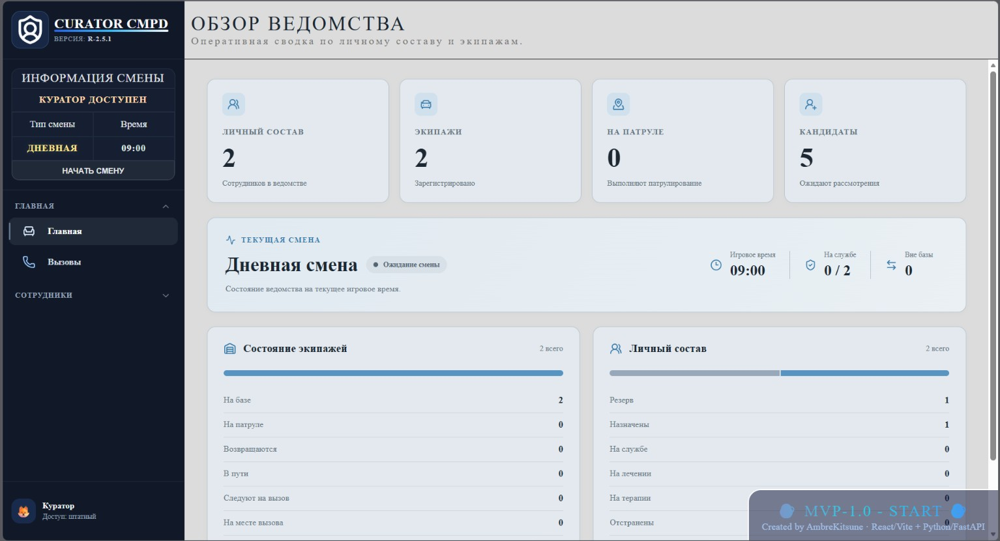
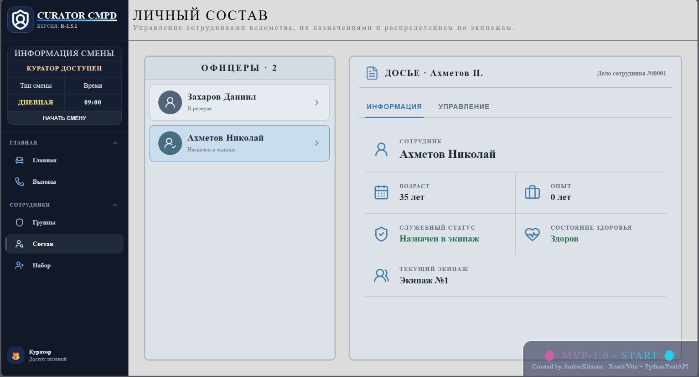
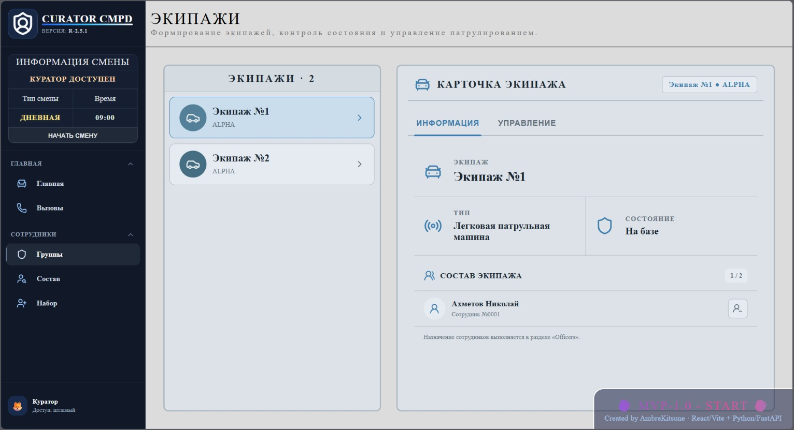

EN / [RU](README.ru.md)

<h1 align="center">CURATOR CMPD - MVP-1.0.0</h1>

---

# Table of Contents 📃
- [Description 😼](#description-)
- [Functions 🛠️](#functions-️)
- [Screenshots 📸](#screenshots-)
- [Stack 📂](#stack-)
- [Quick Start 👾](#quick-start-)
  - [Requirements](#requirements)
  - [Installation](#installation)
  - [Note](#note)
- [Restrictions 📢](#restrictions-)
- [Roadmap 🗺️](#roadmap-️)
  - [MVP-1.0](#mvp-10)
  - [MVP-2.0](#mvp-20)
  - [MVP-2.1](#mvp-21)
  - [MVP-3.0](#mvp-30)
- [License 📄](#license-)
- [Links 🙀](#links-)

---

# Description 😼

CURATOR CMPD is a self-hosted police operations management simulator where the player takes the role of an operational curator.



The project focuses on managing shifts, recruiting candidates, organizing officers, and assigning personnel to police units. **MVP-1.0.0** brings these systems together into a playable management loop: recruit officers, form crews, issue patrol orders, and oversee their return to base at the end of a shift.

This is an early playable version, not the finished game. Development of a desktop application and additional gameplay systems is planned for future releases.

---

# Functions 🛠️

- Shift management with in-game time progression
- Candidate recruitment and acceptance into the department
- Officer roster and assignment to police units
- Police unit management and patrol orders
- Patrol deployment and return-to-base behavior linked to the shift
- Vehicle Designation System (VDS) with vehicle types and crew capacities
- Department dashboard with live staffing and unit statistics
- Real-time synchronization via WebSocket
- Data persistence with SQLite

---

# Screenshots 📸

**Officers**



**Units**



---

# Stack 📂

- React + Vite
- Python + FastAPI
- SQLite
- SQLAlchemy
- WebSocket
- Docker Compose

---

# Quick Start 👾

## Requirements
- Git
- Docker Desktop with Docker Compose (or an equivalent Docker setup)
- Available ports:
  - `27100` — frontend
  - `27101` — backend
- Approximately 1–2 GB of free space
- Windows/Linux; on Windows, enabling WSL2 is recommended

## Installation
1. Clone the repository:
   ```bash
   git clone https://github.com/AmbreKitsune/CuratorCMPD.git
   ```
2. Navigate to `CuratorCMPD/SRC`.
3. Run:
   ```bash
   docker compose up --build
   ```
4. Open http://localhost:27100.
5. API documentation: http://localhost:27101/api/docs.
6. To stop the application, run:
   ```bash
   docker compose down
   ```

## Note
- The SQLite database is created automatically.
- Data is saved in `SRC/data`.
- The first startup may take longer while Docker builds the images.
- `docker compose down -v` also removes Docker-managed volumes; use it only when you intend to remove them.

---

# Restrictions 📢

- The interface is currently available only in Russian (the author's language).
- Call management and emergency response have not yet been implemented.
- Candidate skills and medical information are not yet functional.
- The project is not a finished game.
- It is designed to run locally for a single user.
- Some interface elements and gameplay systems remain unfinished.

---

# Roadmap 🗺️

### MVP-1.0
- [x] Complete recruitment, officer, and unit management for the MVP scope
- [x] Integrate shifts with units and patrol orders
- [x] Add a department dashboard and polish the interface

### MVP-2.0
- [ ] User profile
- [ ] Localization
- [ ] Expanded shift system
- [ ] Curator activity logs and notifications

### MVP-2.1
- [ ] Desktop application
- [ ] Automatic updater

### MVP-3.0
- [ ] Call management
- [ ] Emergency response system

---

# License 📄

Licensed under the PolyForm Noncommercial License 1.0.0. See the [LICENSE](LICENSE) file for details.

Commercial use requires separate permission from AmbreKitsune.

---

# Links 🙀

- **Website**: [Click](https://ambrekitsune.dev/)
- **Telegram**: [@NightAmbreKitsune](https://t.me/NightAmbreKitsune)
- **Discord Server**: [Connect](https://discord.gg/U59cgYUNwv)
