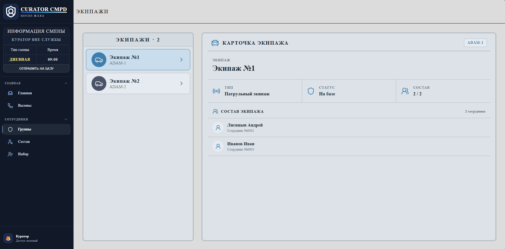

EN / [RU](https://github.com/AmbreKitsune/CuratorCMPD/blob/main/README.ru.md)

<h1 align="center">CURATOR CMPD - DEMO v0.1</h1>

---

# Table of Contents 📃
- [Table of Contents 📃](#table-of-contents-)
- [Description 😼](#description-)
- [Functions 🛠️](#functions-️)
- [Stack 📂](#stack-)
- [Quick Start 👾](#quick-start-)
  - [Requirements](#requirements)
  - [Installation](#installation)
  - [Note](#note)
- [Restrictions 📢](#restrictions-)
- [Roadmap 🗺️](#roadmap-️)
    - [MVP-1.0](#mvp-10)
    - [MVP-2.0](#mvp-20)
    - [MVP-2.1](#mvp-21)
    - [MVP-3.0](#mvp-30)
- [License 📄](#license-)
- [Links 🙀](#links-)

---

# Description 😼

CURATOR CMPD is a self-hosted police operations management simulator where the player takes the role of an operational curator.

The project focuses on managing shifts, recruiting candidates, organizing officers, and assigning personnel to police units. This repository contains an early technical demo created to validate the core gameplay systems, interface, and application architecture before development of the full desktop version.

---

# Functions 🛠️

- Shift management
- Candidate recruitment
- Officer management
- Police unit management
- Real-time synchronization via WebSocket
- Data persistence with SQLite

---

# Stack 📂

- React + Vite
- Python + FastAPI
- SQLite
- SQLAlchemy
- WebSocket
- Docker Compose

---

# Quick Start 👾

## Requirements
- Git
- Install Docker Desktop with Docker Compose
- Have available ports:
   - 27100 — frontend
   - 27101 — backend
- Approximately 1–2 GB of free space
- Windows/Linux; on Windows, having WSL2 enabled is recommended

## Installation
1. Clone the repository.
2. Navigate to CuratorCMPD/SRC.
3. Run `docker compose up --build`.
4. Open http://localhost:27100.
5. API documentation: http://localhost:27101/api/docs.
6. To stop, run `docker compose down`.

## Note
- The SQLite database is created automatically.
- Data is saved in SRC/data.
- The first startup takes longer due to image building.

---

# Restrictions 📢

- Interface available only in Russian (the author's language).
- Call management has not yet been implemented.
- The project is not a finished game.
- It is designed to be run locally by a single user.
- Some interface elements are unfinished.

---

# Roadmap 🗺️

### MVP-1.0
- [ ] Complete recruitment, officer, and unit management
- [ ] Integrate shifts with units
- [ ] Polish the interface

### MVP-2.0
- [ ] User profile
- [ ] Localization
- [ ] Expanded shift system

### MVP-2.1
- [ ] Desktop application
- [ ] Automatic updater

### MVP-3.0
- [ ] Call management
- [ ] Emergency response system

---

# License 📄

Licensed under the PolyForm Noncommercial License 1.0.0. See the [LICENSE](LICENSE) file for details.

Commercial use requires separate permission from AmbreKitsune.

---

# Links 🙀

- **Website**: [Click](https://ambrekitsune.dev/)
- **Telegram**: [@NightAmbreKitsune](https://t.me/NightAmbreKitsune)
- **Discord Server**: [Connect](https://discord.gg/U59cgYUNwv)
