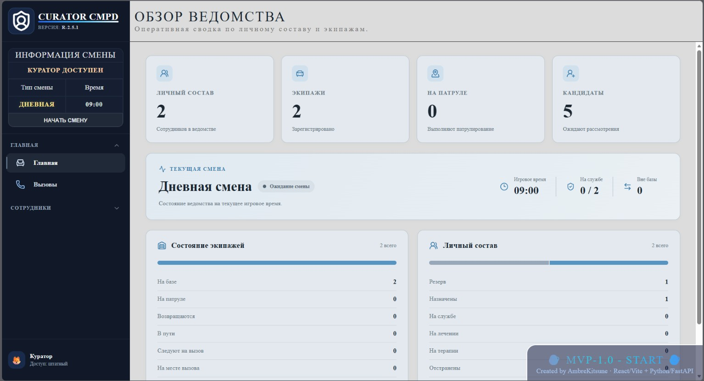
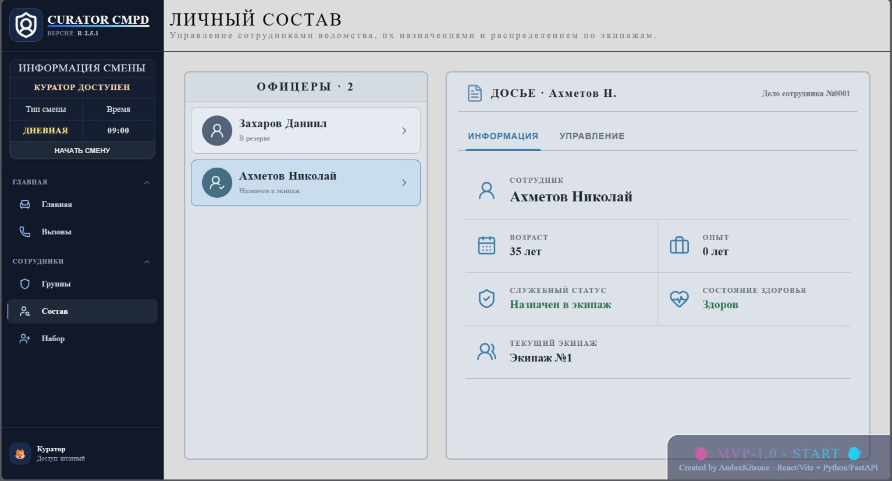
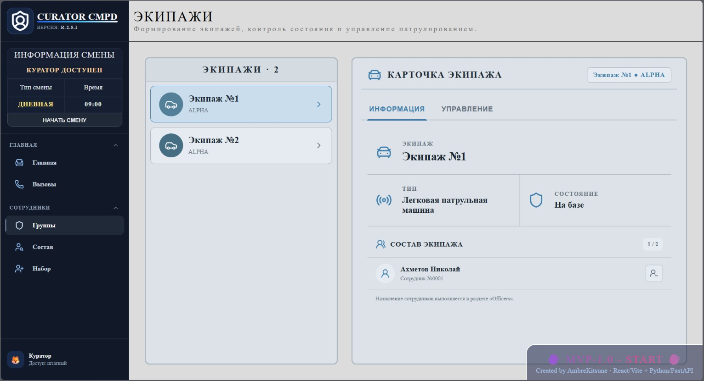

[EN](README.md) / RU

<h1 align="center">CURATOR CMPD - MVP-1.0.0</h1>

---

# Оглавление 📃
- [Описание 😼](#описание-)
- [Функционал 🛠️](#функционал-️)
- [Скриншоты 📸](#скриншоты-)
- [Стек 📂](#стек-)
- [Краткое руководство 👾](#краткое-руководство-)
  - [Требования](#требования)
  - [Установка](#установка)
  - [Примечание](#примечание)
- [Ограничения 📢](#ограничения-)
- [План развития 🗺️](#план-развития-️)
  - [MVP-1.0](#mvp-10)
  - [MVP-2.0](#mvp-20)
  - [MVP-2.1](#mvp-21)
  - [MVP-3.0](#mvp-30)
- [Лицензия 📄](#лицензия-)
- [Ссылки 🙀](#ссылки-)

---

# Описание 😼

CURATOR CMPD — это локально разворачиваемый симулятор управления полицейскими операциями, в котором игрок берёт на себя роль оперативного куратора.



Проект посвящён управлению сменами, подбору кандидатов, организации работы сотрудников и формированию полицейских экипажей. В версии **MVP-1.0.0** эти механики объединены в единый игровой процесс: набор сотрудников, комплектование экипажей, выдача распоряжений о патрулировании и возвращение экипажей на базу по завершении смены.

Это ранняя игровая версия, а не законченный проект. Полноценное приложение для ПК и дополнительные игровые системы запланированы на будущие обновления.

---

# Функционал 🛠️

- Управление сменами и течением игрового времени
- Рассмотрение и приём кандидатов на службу
- Управление личным составом и назначение сотрудников в экипажи
- Управление экипажами и распоряжениями о патрулировании
- Выезд на патруль и возвращение на базу с учётом состояния смены
- Система обозначений транспорта VDS с типами машин и вместимостью экипажей
- Главная страница Dashboard с актуальной сводкой по сотрудникам и экипажам
- Синхронизация в реальном времени через WebSocket
- Сохранение данных с использованием SQLite

---

# Скриншоты 📸

**Личный состав (Officers)**



**Экипажи (Units)**



---

# Стек 📂

- React + Vite
- Python + FastAPI
- SQLite
- SQLAlchemy
- WebSocket
- Docker Compose

---

# Краткое руководство 👾

## Требования
- Git
- Docker Desktop с Docker Compose (или аналогичная установка Docker)
- Свободные порты:
  - `27100` — frontend
  - `27101` — backend
- Примерно 1–2 ГБ свободного места
- Windows/Linux; для Windows рекомендуется включить WSL2

## Установка
1. Клонировать репозиторий:
   ```bash
   git clone https://github.com/AmbreKitsune/CuratorCMPD.git
   ```
2. Перейти в `CuratorCMPD/SRC`.
3. Запустить:
   ```bash
   docker compose up --build
   ```
4. Открыть http://localhost:27100.
5. Документация API: http://localhost:27101/api/docs.
6. Для остановки выполнить:
   ```bash
   docker compose down
   ```

## Примечание
- База данных SQLite создаётся автоматически.
- Данные сохраняются в папке `SRC/data`.
- Первый запуск может занять больше времени из-за сборки Docker-образов.
- Команда `docker compose down -v` также удаляет тома Docker. Используйте её только в случае, если действительно хотите удалить эти данные.

---

# Ограничения 📢

- Интерфейс пока доступен только на русском языке (языке автора).
- Управление вызовами и система экстренного реагирования ещё не реализованы.
- Вкладки навыков и медицинских заключений кандидатов пока не работают.
- Проект не является завершённой игрой.
- Он предназначен для локального запуска одним пользователем.
- Некоторые элементы интерфейса и игровые механики ещё находятся в разработке.

---

# План развития 🗺️

### MVP-1.0
- [x] Реализовать найм, управление сотрудниками и экипажами в рамках MVP
- [x] Интегрировать смены с экипажами и распоряжениями о патрулировании
- [x] Добавить Dashboard и доработать интерфейс

### MVP-2.0
- [ ] Профиль пользователя
- [ ] Локализация
- [ ] Расширенная система смен
- [ ] Логи и уведомления Куратора

### MVP-2.1
- [ ] Приложение для ПК
- [ ] Система автоматического обновления

### MVP-3.0
- [ ] Управление вызовами
- [ ] Система экстренного реагирования

---

# Лицензия 📄

Распространяется на условиях лицензии PolyForm Noncommercial License 1.0.0. Подробности см. в файле [LICENSE](LICENSE).

Для коммерческого использования требуется отдельное разрешение от AmbreKitsune.

---

# Ссылки 🙀

- **Сайт**: [Открыть](https://ambrekitsune.dev/)
- **Telegram**: [@NightAmbreKitsune](https://t.me/NightAmbreKitsune)
- **Discord Server**: [Присоединиться](https://discord.gg/U59cgYUNwv)
